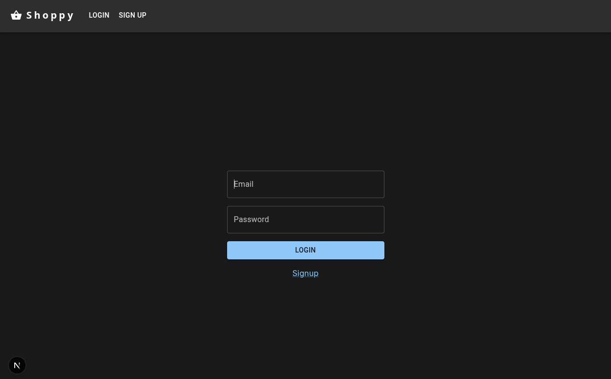

# Shoppy - E-commerce Platform

A modern e-commerce platform built with Next.js, NestJS, and Stripe integration.



## Project Structure

This monorepo contains the following applications and packages:

### Apps

- `shoppy-ui`: Next.js frontend application
- `shoppy-backend`: NestJS backend API service

## Features

- 🛍️ Product listings and management
- 💳 Secure payments via Stripe integration
- 🔐 User authentication
- 🖼️ Product image handling
- 🔄 Real-time updates using WebSockets
- 🛡️ TypeScript for type safety

## Tech Stack

- **Frontend**: Next.js, React, TailwindCSS
- **Backend**: NestJS, Prisma
- **Database**: PostgreSQL (via Neon)
- **Payment**: Stripe
- **Development**: Turborepo, TypeScript

## Getting Started

### Prerequisites

- Node.js 18+
- pnpm
- PostgreSQL database
- Stripe account

### Environment Setup

1. Clone the repository:
```bash
git clone <repository-url>
cd shoppy
```

2. Install dependencies:
```bash
pnpm install
```

3. Create the environment files below. Keep secret values local and do not commit them.

    In `apps/shoppy-backend/.env`, configure:

    - `DATABASE_URL`: PostgreSQL connection string used by Prisma.
    - `STRIPE_SECRET_KEY`: Stripe secret key used by the backend.
    - `JWT_SECRET`: secret used to sign and verify authentication tokens.
    - `JWT_EXPIRATION`: token lifetime, such as `1d`.
    - `PORT`: port for the backend HTTP server.
    - `API_URL`: present in the local backend configuration, but not currently read by the backend code.

    In `apps/shoppy-ui/.env.local`, configure:

    - `NEXT_PUBLIC_API_URL`: base URL of the backend API.
    - `NEXT_PUBLIC_STRIPE_PUBLIC_KEY`: Stripe publishable key used by the browser checkout flow.

    Next.js loads `.env.local` automatically. Variables prefixed with `NEXT_PUBLIC_` are included in browser code, so only put public values there; never put secrets in this file.

### Development

Run the development servers:

```bash
# Start all services
pnpm dev

# Start specific app
pnpm dev --filter=shoppy-ui
pnpm dev --filter=shoppy-backend
```

### Building

```bash
# Build all apps
pnpm build

# Build specific app
pnpm build --filter=shoppy-ui
pnpm build --filter=shoppy-backend
```

## API Documentation

Backend API endpoints are documented using Swagger and available at:
```
http://localhost:3001/api
```

## Contributing

1. Create a feature branch
2. Commit your changes
3. Push to your branch
4. Create a Pull Request

## License

This project is licensed under the MIT License - see the LICENSE file for details

